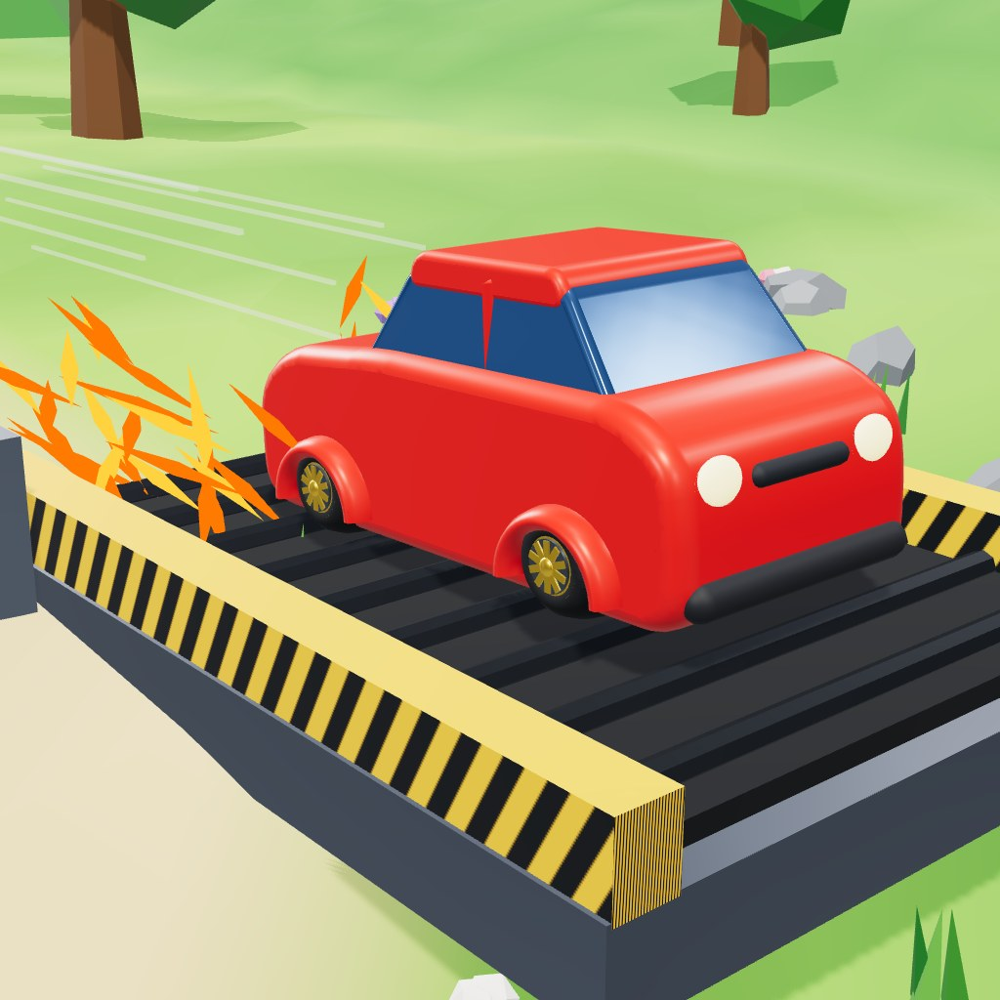

# Hill Kicker



**Lance. Glisse. Améliore.** Jeu mobile en 3D low-poly (Three.js), en mode portrait.

Le joueur lance une petite voiture depuis un tapis roulant motorisé : il maintient le bouton, la jauge monte de 0 à 100 %, puis il relâche. La voiture dévale ensuite d'immenses pentes en roue libre. Seul le relief la ralentit. On ramasse des pièces et des gemmes, on enchaîne flips et tonneaux, puis on améliore la voiture pour aller toujours plus loin, jusqu'à la ligne d'arrivée.

Le document de conception complet est dans [docs/GDD.md](docs/GDD.md).

## État du projet

| Élément | État |
| --- | --- |
| Game design (GDD) | Rédigé |
| Maquettes des écrans | Faites (rendus 3D + interface) |
| Modèles 3D des 20 véhicules | Faits (`src/assets3d.js`) |
| Terrain, décors, lanceur, pièces, gemmes | Faits (`src/assets3d.js`) |
| Boucle de jeu jouable (prototype) | Faite : lanceur, course, cascades, booster, pièces, résultats, coffre, vies, améliorations, garage |
| Sons (moteur, pièces, boosts, cascades) | Faits |
| Mondes (paysages par niveau) | 10 sur 20 faits (`src/game/themes.js`) ; le jeu reboucle après le dernier |
| Visuels par palier d'amélioration | À faire |

## Jouer

```bash
npm install
npm run serve
```

Ouvre http://localhost:8080 sur ton téléphone (même réseau) ou ton ordinateur. Sur ordinateur : souris pour le lanceur, flèches pour diriger, flèche haut pour un flip en l'air, espace pour le booster.

Pour jouer en ligne sans rien installer, active GitHub Pages sur la branche `main` (Settings › Pages) : le jeu sera alors sur https://nanou974.github.io/Hill-Kicker/.

## Appli Android

L'APK est compilé automatiquement par GitHub Actions (`.github/workflows/android.yml`) :

- chaque push sur `main` produit un APK dans l'onglet **Actions** ;
- chaque nouvelle version crée une **release** avec l'APK à télécharger : https://github.com/nanou974/Hill-Kicker/releases

Pour publier une nouvelle version : augmenter `VERSION` dans `src/game/version.js` (et `package.json`), mettre à jour `docs/release-notes.md`, puis pousser sur `main`.

L'APK est signé avec une clé de test présente dans le dépôt (`android/app/hillkicker-test.keystore`). Pour le Play Store, il faudra une clé privée fournie par les secrets GitHub (`KEYSTORE_FILE`, `KEYSTORE_PASSWORD`, `KEY_ALIAS`, `KEY_PASSWORD`).

En local (avec le SDK Android installé) : `npm run build:app`, puis ouvrir `android/` dans Android Studio.

## Structure

```
index.html              Le jeu
src/game/               Boucle de jeu : physique, monde, économie, interface, joystick
src/assets3d.js         Modèles low-poly procéduraux : 20 véhicules, terrain, arbres, lanceur, pièces, gemmes…
preview/garage.html     Visionneuse 3D interactive des 20 véhicules
tools/render/           Rendu headless des scènes et vignettes (Chromium + Three.js)
tools/sim.mjs           Simulation de calibrage (distance par lancer, progression jusqu'à l'arrivée)
tools/playtest*.mjs     Parties automatisées dans Chromium headless, avec captures
assets/icon/            Icône de l'application
assets/renders/         Rendus des scènes, des véhicules et des icônes d'amélioration
docs/GDD.md             Document de conception
```

## Lancer la visionneuse des véhicules

```bash
npm install
npm run serve
```

Ouvre ensuite http://localhost:8080/preview/garage.html. Glisse pour tourner autour du véhicule, et utilise la barre du bas pour changer de modèle.

## Régénérer les rendus

```bash
npm install
npm run render -- '[{"s":"course","file":"scenes/course.jpg"},{"s":"thumb","car":"taxi","file":"vehicules/t_taxi.png","w":360,"h":240}]'
```

Scènes disponibles : `launch`, `launch100`, `faux`, `course`, `cascade`, `results`, `home`, `hero`, `thumb`, `icon`, `appicon`. Le paramètre `car` accepte les clés de `ORDER` dans `src/assets3d.js`. Si Chromium n'est pas trouvé automatiquement, indique son chemin avec la variable `CHROME_PATH`.
